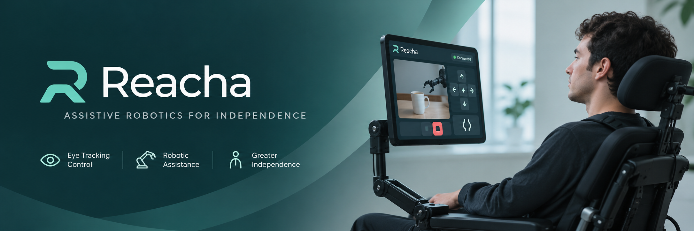
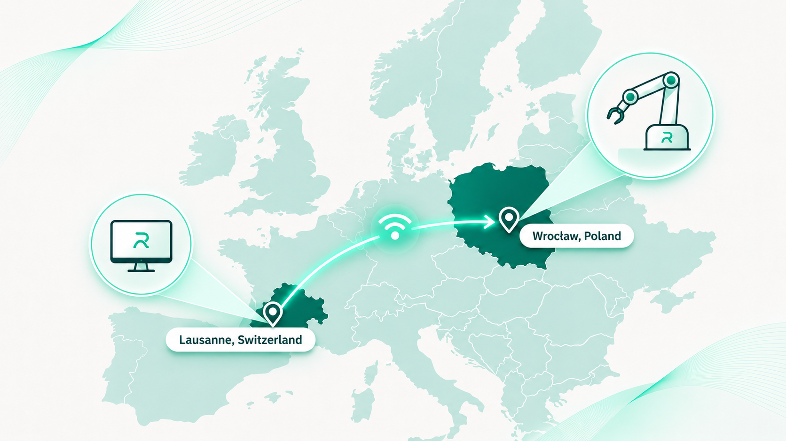
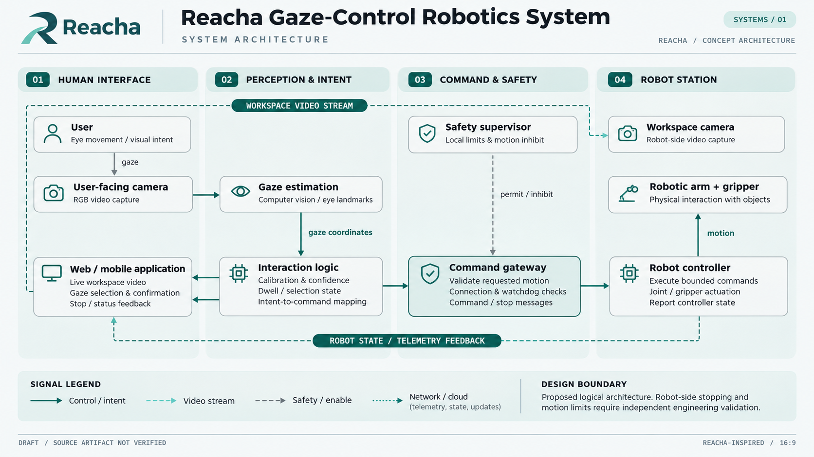
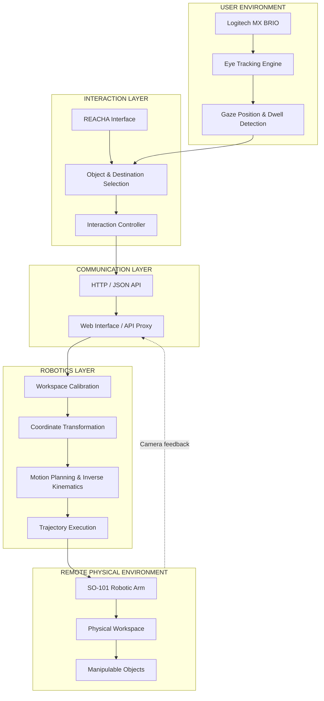
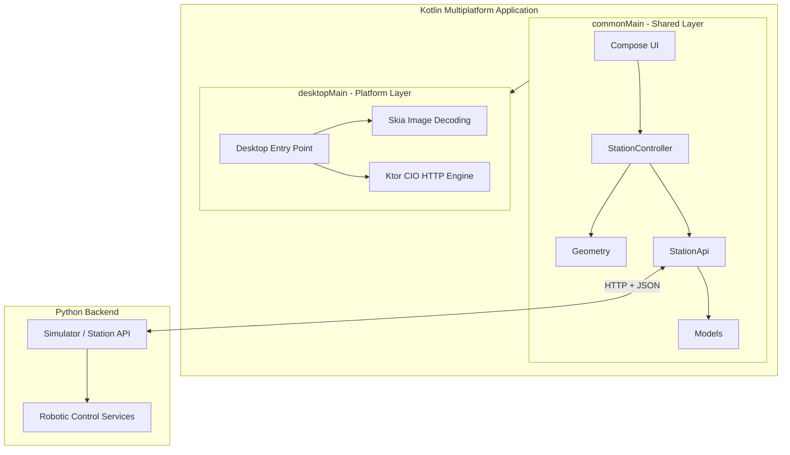

<div align="center">

# REACHA




**Enabling independent robotic manipulation through eye tracking for people with motor disabilities.**

[](https://lauzhack.com/)
[](https://www.logitech.com/)
[](https://www.jetbrains.com/)
[](https://www.imc.com/)

<br/>

[**Live Project Website**](https://claude.ai/artifact/NsY2vBKaEEffSLKGwzH8wE) · [**Source Code**](https://github.com/jakub-staudt/lauzhack_roboticarm)

<br/>

</div>


---

## Overview

What if someone could interact with the physical world without moving their hands?

For people living with severe motor impairments, even simple everyday actions - moving an object, reaching for something, or interacting with their surroundings - can require assistance from another person.

**REACHA** explores a different approach: using eye movements as a natural input mechanism to control a physical robotic arm remotely.

By combining computer vision, eye tracking, robotic manipulation and cross-platform software, REACHA enables a user to select and manipulate physical objects simply by looking at them.

The user interacts with a virtual representation of a physical workspace displayed on a screen. By maintaining their gaze on an object for approximately three seconds, they select it. They can then choose a destination and initiate a robotic manipulation task.

The robotic arm executes the requested movement in a remote physical environment, while the user remains in control through an accessible visual interface.

**The result is a system that transforms visual attention into physical interaction.**

---

## The problem

Traditional robotic interfaces rely on physical input devices:

- Mouse and keyboard.
- Touchscreens.
- Joysticks and controllers.
- Physical buttons.

These interaction methods can be inaccessible to people with conditions that severely restrict voluntary movement.

Eye tracking offers an alternative input modality: instead of requiring physical interaction, the system interprets where the user is looking.

REACHA takes this concept beyond conventional eye-controlled interfaces. Rather than simply moving a cursor or navigating a screen, it connects visual attention to the manipulation of real-world objects.

Our goal is to make robotic interaction more accessible, intuitive and independent.

---

## The solution

REACHA combines three main components:

1. **Eye Tracking:** a Logitech MX BRIO camera captures the user's eye movements and determines their point of visual attention.
2. **Interaction Interface:** a visual workspace allows the user to select objects and specify manipulation commands through gaze-based interaction.
3. **Robotic Manipulation:** a remotely connected SO-101 robotic arm performs the corresponding physical actions.

The system follows a simple interaction model:

1. The user looks at an object on the screen.
2. The eye-tracking system detects a stable gaze position.
3. A dwell-time mechanism confirms the selection after approximately three seconds.
4. The user selects a destination or another available action.
5. The application translates the selection into workspace coordinates.
6. The robotic system plans and executes the corresponding movement.
7. The user can observe the result through the remote camera feed.

The interface also provides alternative interaction mechanisms, including direct point selection and explicit movement confirmation.

---

## Demonstration

**A remote robotic workspace controlled through eye tracking.**



The physical robotic arm is located in Poland, while the user interacts with the system from a device.

The application displays a representation of the remote workspace, allowing the user to interact with objects without physically accessing the robot or its environment.

The communication architecture connects the local interaction interface to the remote robotic infrastructure.

<!-- Add demonstration GIF or video here -->
<!-- Example:  -->

### Example interaction

| User action | System response |
|---|---|
| Looks at a red cube | Gaze position is tracked |
| Maintains gaze for 3 seconds | Red cube is selected |
| Selects a destination | Target position is registered |
| Confirms the operation | Manipulation task is initiated |
| Robot completes the movement | Cube reaches its destination |

---

# System Architecture

REACHA is designed as a modular, distributed system. Its architecture separates visual input, interaction logic, geometric transformations, robotic planning and hardware execution.

This separation allows individual components to be developed, tested and improved independently.




## High-level architecture



The diagram represents the logical system architecture. The individual components can also operate against the simulator during development and testing.

## Component architecture

### 1. Eye Tracking Layer

The eye-tracking subsystem uses a Logitech MX BRIO camera to capture the user's visual input.

Its responsibility is to convert eye movements into meaningful screen coordinates.

The interaction model uses dwell-based selection:

- Gaze coordinates are continuously estimated.
- A stable point of attention is identified.
- A dwell timer measures how long the user maintains their gaze.
- Once the threshold is reached, a selection event is generated.

The eye-tracking subsystem communicates with the rest of the application through a lightweight JSON event contract.

Example selection event:

```json
{
  "type": "select",
  "u": 0.42,
  "v": 0.71
}
```

Coordinates are normalized to the workspace:

- `u`: horizontal position, between 0 and 1.
- `v`: vertical position, between 0 and 1.

Additional events support resetting the interaction state and optionally transmitting live gaze positions.

This interface decouples gaze estimation from robotic control: the robotics subsystem does not need to know how the user's eyes are tracked.

### 2. Interaction Layer

The interaction layer translates user intent into manipulation commands.

The user sees a visual representation of the workspace, including the available objects and their possible destinations.

The interface supports:

- Object selection.
- Destination selection.
- Move commands.
- Explicit movement confirmation.
- Emergency stop and movement cancellation.
- Workspace reset.
- Visual feedback from the remote environment.

The application maintains the interaction state and coordinates the transition from user selection to robotic execution.

### 3. Coordinate Transformation and Calibration

A fundamental challenge in remote robotic manipulation is ensuring that a point selected on a screen corresponds to the correct physical location on the robot's table.

REACHA addresses this through workspace calibration and geometric transformations.

The system works with normalized workspace coordinates and maps them to the robotic arm's coordinate frame.

Calibration uses known reference points on the workspace and the corresponding positions measured by the robot.

A planar homography provides the mapping between normalized table coordinates and the robot's base-frame coordinates.

Conceptually:

$$
(u,v) \longrightarrow (x,y)
$$

where:

- \((u,v)\) represents a normalized position on the workspace.
- \((x,y)\) represents the corresponding position in the robot's coordinate frame.

The calibration module also evaluates residual errors to assess the quality of the transformation.

This geometric layer is essential for reliable manipulation: an accurate gaze selection is not sufficient if the corresponding physical position is incorrectly estimated.

### 4. Robotic Planning and Execution

The robotic subsystem is responsible for translating target coordinates into executable movements.

REACHA integrates with the SO-101 robotic arm and its underlying RAMION control infrastructure.

The robotics pipeline includes:

- Workspace calibration.
- Inverse kinematics.
- Joint-space trajectory planning.
- Motion execution.
- Controller communication.
- Movement monitoring and cancellation.

The motion planner uses the robot's kinematic model to determine feasible joint configurations for a desired end-effector position.

A pick-and-place operation can be represented as a sequence of waypoints:

1. Move above the source object.
2. Approach the object.
3. Grasp the object.
4. Lift it from the workspace.
5. Move towards the destination.
6. Lower and release the object.
7. Return to a safe configuration.

Motion planning is separated from execution, allowing trajectories to be evaluated independently before being sent to the physical controller.

### 5. Remote Communication

The physical robot and the user's interface operate in separate environments.

Communication is handled through HTTP-based services and JSON messages.

The system uses a proxy layer to expose the required controller functionality to the user-facing applications.

This architecture supports:

- Remote camera access.
- Robot state monitoring.
- Control ownership management.
- Movement commands.
- Heartbeat and session management.
- Stop and cancellation operations.

The system is designed to account for network latency and intermittent connectivity, which are particularly relevant when controlling hardware remotely.

---

# JetBrains Track: Kotlin Multiplatform Architecture

REACHA includes a dedicated Kotlin Multiplatform application developed as part of the JetBrains challenge.

The objective was to build a native-feeling application that can serve as the interaction interface for the robotic workspace, while keeping the application logic independent of the operating system.

Instead of implementing the same interface and interaction logic separately for different platforms, we use **Compose Multiplatform and Kotlin Multiplatform (KMP)** to share the application code.

## Architecture overview

The current application targets the JVM Desktop environment, supporting macOS, Windows and Linux.

Its architecture separates shared application logic from platform-specific implementations.



## Shared application layer

The `commonMain` source set contains the core application functionality.

It is responsible for:

- UI composition and reusable interface components.
- Application state management.
- User interaction logic.
- Workspace geometry and coordinate transformations.
- API communication.
- Data models and serialization.

The shared layer is implemented using:

| Technology | Responsibility |
|---|---|
| Kotlin | Application language |
| Compose Multiplatform | Declarative UI |
| Ktor Client | HTTP communication |
| Kotlinx Serialization | JSON serialization and deserialization |
| Kotlin Coroutines | Asynchronous operations |

The shared architecture ensures that application behaviour is not tightly coupled to a specific desktop operating system.

## Desktop platform layer

The `desktopMain` source set provides the platform-specific implementations required by the desktop application.

It includes:

- Desktop application entry point.
- Window and application lifecycle.
- Skia-based image decoding.
- Ktor CIO HTTP engine.
- Desktop-specific coroutine integration.

The platform abstraction uses Kotlin's `expect` / `actual` mechanism for functionality that requires different implementations across targets.

For example, image decoding is declared in the shared code and implemented specifically for Desktop.

## Code organization

The Kotlin application follows this structure:

```text
kmp_app/
├── composeApp/
│   └── src/
│       ├── commonMain/
│       │   └── kotlin/ch/lauzhack/gaze/
│       │       ├── api/
│       │       │   ├── Models.kt
│       │       │   └── StationApi.kt
│       │       ├── Geometry.kt
│       │       ├── StationController.kt
│       │       ├── Platform.kt
│       │       └── ui/
│       │           ├── Theme.kt
│       │           ├── App.kt
│       │           ├── CameraView.kt
│       │           └── ControlPanel.kt
│       │
│       └── desktopMain/
│           └── kotlin/ch/lauzhack/gaze/
│               ├── Main.kt
│               ├── Platform.desktop.kt
│               └── Snapshot.kt
│
├── gradle/
├── gradlew
└── build.gradle.kts
```

### Main architectural responsibilities

| Component | Responsibility |
|---|---|
| `StationController.kt` | Application state and interaction orchestration |
| `Geometry.kt` | Coordinate transformations between screen pixels, workspace and block coordinates |
| `StationApi.kt` | Communication with the Python backend |
| `Models.kt` | API data models |
| `App.kt` | Main Compose application interface |
| `CameraView.kt` | Workspace camera visualization |
| `ControlPanel.kt` | User interaction and robotic controls |
| `Platform.kt` | Platform-independent declarations |
| `Platform.desktop.kt` | Desktop-specific implementations |
| `Main.kt` | Desktop application entry point |

## Multiplatform design strategy

A central design decision was to keep the majority of the application in `commonMain`.

This means that adding new platforms does not require rewriting the interaction logic or the workspace geometry.

The architecture is designed to support future targets such as:

- Android.
- iOS.
- Additional desktop environments.

These targets require their own platform configuration and implementations where necessary.

The repository also contains a separate `mobile_app/` directory for the native iPhone application prototype.

**The current Compose Multiplatform client is a Desktop application; Android, iOS and Web are architectural extension points rather than currently supported targets of this client.**

## Running the Kotlin application

Requirements:

- JDK 17.
- Gradle (the project includes the Gradle wrapper).
- Python environment running the simulator backend.

Start the backend from the repository root:

```bash
python3 -m venv .venv-sim
source .venv-sim/bin/activate

pip install -r simulator/requirements.txt

python -m simulator.web.server
```

The simulator server is available at:

```text
http://127.0.0.1:8810
```

In another terminal:

```bash
cd kmp_app

./gradlew :composeApp:run
```

To connect to another server:

```bash
./gradlew :composeApp:run --args="http://HOST:8810"
```

Alternatively, configure the server URL through the `GAZE_STATION_URL` environment variable.

The desktop application can also be packaged for the supported operating systems:

```bash
./gradlew :composeApp:packageDmg
./gradlew :composeApp:packageMsi
./gradlew :composeApp:packageDeb
```

Each native package must be built on its corresponding operating system.

---

# Technology Stack

REACHA brings together technologies from computer vision, robotics, distributed systems and cross-platform application development.

| Domain | Technologies |
|---|---|
| Eye Tracking | Logitech MX BRIO, gaze estimation, dwell-based selection |
| Application Development | Kotlin, Kotlin Multiplatform |
| UI Framework | Compose Multiplatform |
| Networking | Ktor, HTTP, JSON |
| Serialization | Kotlinx Serialization |
| Concurrency | Kotlin Coroutines |
| Robotics | SO-101, RAMION |
| Motion Planning | Inverse Kinematics, trajectory planning |
| Simulation | MuJoCo, Gazebo |
| Computer Vision | OpenCV, AprilTags, perspective geometry |
| Backend | Python, HTTP services |
| Remote Connectivity | Tailscale |
| Development Environment | IntelliJ IDEA, Gradle |

---

# Repository Structure

The project is organized into independent modules, each responsible for a specific part of the system.

```text
REACHA/
│
├── eye_tracking/
│   └── Gaze detection, dwell selection and
│       communication interface
│
├── kmp_app/
│   └── Kotlin Multiplatform desktop application
│       ├── Shared Compose UI
│       ├── Application state
│       ├── Geometry
│       └── API integration
│
├── mobile_app/
│   └── Native iOS application prototype
│
├── lauzkach_eye_robot_control/
│   └── Camera-based workspace detection,
│       geometric alignment and correction
│
├── robotic_arm/
│   └── Robotic control and motion planning
│       ├── calibration.py
│       ├── planner.py
│       ├── executor.py
│       └── config.py
│
├── simulator/
│   └── Virtual robotic environment
│       ├── MuJoCo simulation
│       ├── Gazebo integration
│       ├── Web interface
│       └── Workspace geometry
│
├── web_ui/
│   └── Remote robotic control interface
│
├── monorepo-main/
│   └── RAMION robotic infrastructure
│
├── gaze_pick_place.py
├── gaze_scene_v2.py
├── requirements.txt
└── README.md
```

### Module responsibilities

| Module | Description |
|---|---|
| `eye_tracking/` | Converts visual attention into normalized interaction events |
| `kmp_app/` | Cross-platform application architecture and desktop UI |
| `mobile_app/` | Native iOS application prototype |
| `lauzkach_eye_robot_control/` | Camera-based workspace detection and geometric alignment |
| `robotic_arm/` | Calibration, inverse kinematics and robotic execution |
| `simulator/` | Virtual environment for development and testing |
| `web_ui/` | Remote camera visualization and robotic control |
| `monorepo-main/` | Underlying RAMION robotic control infrastructure |

---

# Simulation and Testing

Developing a remote robotic manipulation system requires a safe and reproducible environment.

REACHA includes a simulation environment based on MuJoCo, allowing the robotic workspace and its interactions to be tested without requiring continuous access to the physical hardware.

The simulator models:

- The SO-101 robotic arm.
- The manipulation table.
- The available objects.
- The gripper.
- The overhead camera.
- The robot's kinematic configuration.

It provides a web interface through which users can select objects and destinations.

The same interaction model can be used with the Kotlin application, allowing the user-facing software to communicate with a simulated robotic environment through the same API.

### Running the simulator

From the repository root:

```bash
python3 -m venv .venv-sim
source .venv-sim/bin/activate

pip install -r simulator/requirements.txt

python -m simulator.web.server
```

Open:

```text
http://127.0.0.1:8810
```

To launch the interactive MuJoCo viewer:

```bash
python -m simulator.run
```

On macOS:

```bash
mjpython -m simulator.run
```

Gazebo is also supported as an alternative simulation backend.

---

# Installation and Setup

## Prerequisites

Depending on which components you want to run, you will need:

- Python 3.
- JDK 17.
- Git.
- Gradle (wrapper included).
- MuJoCo dependencies.
- OpenCV dependencies for the computer vision modules.
- Access to the robotic controller for physical hardware operation.

## Clone the repository

```bash
git clone https://github.com/jakub-staudt/lauzhack_roboticarm.git

cd lauzhack_roboticarm
```

## Python environment

Create an environment for the simulator:

```bash
python3 -m venv .venv-sim

source .venv-sim/bin/activate

pip install -r simulator/requirements.txt
```

For the robotic arm module, use its dedicated environment:

```bash
cd robotic_arm

python3 -m venv .venv

.venv/bin/pip install mujoco numpy scipy pyyaml pytest

.venv/bin/pip install --no-deps -e ../monorepo-main/apps/arm-workbench/packages/soarm

.venv/bin/pip install --no-deps -e ../monorepo-main/apps/arm-workbench/packages/soarm_lab

.venv/bin/pip install --no-deps -e .
```

Configure the robotic controller using the example configuration:

```bash
cp config.example.yaml config.yaml
```

Set the appropriate controller endpoint in `config.yaml`.

## Kotlin application

```bash
cd kmp_app

./gradlew :composeApp:run
```

Make sure the simulator or the intended backend is running before launching the client.

---

# Safety and Reliability

Remote robotic manipulation requires explicit safety mechanisms.

REACHA incorporates several design principles to reduce the risk of unintended movement.

### Movement authorization

Movement commands are separated from gaze selection.

The system can require explicit confirmation before executing a manipulation task, preventing accidental selections from immediately triggering physical actions.

### Emergency stop

The interface provides a STOP mechanism to interrupt ongoing movement.

The system also supports movement cancellation and control release.

### Control ownership

Only one application should hold control of the robotic arm at a time.

The control infrastructure uses ownership and heartbeat mechanisms to prevent conflicting commands.

### Motion constraints

The robotic planner accounts for:

- Joint limits.
- Workspace boundaries.
- Reachability.
- Safe approach heights.
- Feasible inverse kinematics solutions.

### Remote operation

Network latency and intermittent connectivity are considered in the control architecture.

The system should never be operated without appropriate physical supervision and access to the hardware emergency stop.

**REACHA is a research and hackathon prototype, not a certified medical or assistive device. It is not intended to replace professional assistive technology or clinical evaluation.**

---

# Future Development

REACHA establishes a foundation for more advanced gaze-controlled robotic interaction.

Several extensions could substantially improve the system.

## Binocular / Stereo Vision

The current configuration uses a single camera for gaze input.

A natural extension would be to introduce a second camera:

- An eye-facing camera dedicated to tracking the user's gaze.
- A forward-facing camera observing the user's environment.

Combining the two sources could provide a richer representation of the user's visual attention and physical surroundings.

With appropriate calibration and camera geometry, this could support a more complete spatial representation of the environment.

Potential benefits include improved spatial interaction, contextual object selection and more natural control.

---

# Project Vision

REACHA is built around a simple principle:

**Physical limitations should not prevent people from interacting with the world around them.**

By combining gaze-based interaction with accessible software and robotic manipulation, we explore how everyday physical tasks could become possible through alternative input methods.

The current implementation focuses on a controlled pick-and-place environment, but the underlying concept has much broader potential.

From assistive robotics to remote manipulation, REACHA represents a step towards more inclusive human–robot interaction.

---


<div align="center">

### REACHA

#### Assistive robotics for independence

*Technology should adapt to people, not the other way around.*

[Live Website](https://claude.ai/artifact/NsY2vBKaEEffSLKGwzH8wE) · [GitHub Repository](https://github.com/jakub-staudt/lauzhack_roboticarm)

</div>
