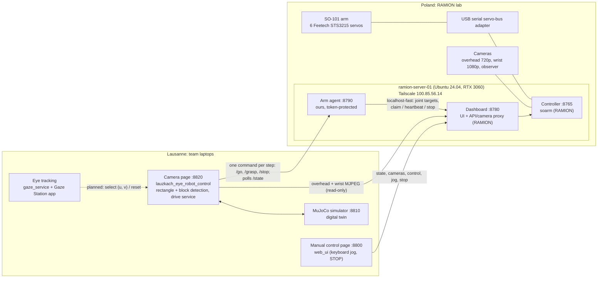
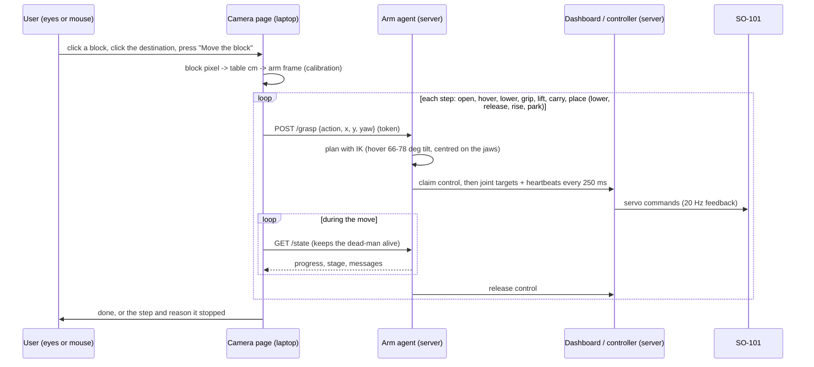

# LauzHack 2026: eye-controlled pick and place with a remote SO-101 arm

A person who cannot use their hands looks at a block on a screen, then at where it should go, and a robot arm in
another country moves it. The arm, its cameras and the RAMION server are in **Poland**; the people using it are at
LauzHack in Lausanne. Everything between them runs over **Tailscale**.

This page describes the system design. Each folder has its own README with the details.

## System architecture

### In Poland (RAMION's lab)

| Part | What it is | Owner |
|---|---|---|
| **SO-101 arm** | 5-axis arm + gripper, six Feetech STS3215 bus servos, connected to the server by a USB serial bus adapter. | RAMION |
| **Cameras** | Overhead (Innomaker 720p) looking down on the table, wrist camera (1080p) on the gripper, an observer camera for people watching. | RAMION |
| **Table** | Paper with a printed grid and AprilTags (36h11) at the corners. We work only in the **left 20 × 20 cm square**: the arm cannot reach the right part. | RAMION / us |
| **ramion-server-01** | Ubuntu Server 24.04, RTX 3060. Runs RAMION's services; joined to the Tailscale network as `100.85.56.14`. | RAMION |
| **Controller `:8765`** | `soarm` from RAMION's monorepo: talks to the servos at 20 Hz, owns the cameras, enforces the control lease, joint/EEPROM limits, the tip floor above the table, and the STOP latch. | RAMION |
| **Dashboard `:8780`** | RAMION's operator UI. It also proxies the controller's `/api/...` and `/cameras/...` routes, keeps connections alive, and streams the cameras as MJPEG (2 to 20 fps). **Every laptop talks to the arm through here.** | RAMION |
| **Arm agent `:8790`** | Our process (`lauzkach_eye_robot_control/arm_agent.py`) in the SSH user's home, started by hand in tmux, not at boot. It plans and drives a move next to the arm. Token-protected, Tailscale address only. | us |

RAMION's services are not ours to change: we only call their public API. See `CLAUDE.md` for the rules
(never break the server, ask before SSH or deploys, never move the real arm unsupervised, keep torque on).

### In Lausanne (laptops)

| Part | Folder | Port | Role |
|---|---|---|---|
| **Camera page** | `lauzkach_eye_robot_control/` | 8820 | Finds the table rectangle (AprilTags + printed lines, fitted to one perspective grid, ~1 mm) and the blocks (by colour) in the overhead stream; maps pixels to table cm and to the arm's frame; the staged grasp / pick-and-place controls. Drives the simulator, or the real arm through the agent (`--real-agent`). |
| **Manual control** | `web_ui/` | 8800 | Keyboard hold-to-move, take/release control, STOP; a same-origin proxy to the dashboard. |
| **Real-arm library** | `robotic_arm/` | – | Calibration (table point ↔ arm frame), IK planning with `soarm_lab`, click-to-move. Used by the page and the agent. |
| **Simulator** | `simulator/` | 8810 | MuJoCo SO-101 with the same table: a digital twin to try moves and grasp settings before the real arm (grasp search results in `simulator/grasp_search_results/`). |
| **Eye tracking** | `gaze_pick_place.py`, `gaze_scene_v2.py`; `gaze_service/` + `kmp_app/` on branch `kmp-setup` | 8820* | EyeGestures on the laptop's camera; dwell to choose a block and a destination. The Gaze Station app (Kotlin Multiplatform, desktop + Android) currently drives the simulator. |

\* `gaze_service` and the camera page both default to port 8820: run one of them on another port (`--port`) when
both are needed.

## Network

- **Tailscale** connects the laptops and the server. The path is usually **relayed through DERP Frankfurt**
  (no direct connection was established): 40–55 ms round trip, with spikes of 360–900 ms and one two-minute outage
  seen. `tailscale ping 100.85.56.14` shows the current path.
- Nothing is exposed to the internet: the dashboard, controller and agent listen on the server's Tailscale address.
- Bandwidth is shared: the overhead stream at 20 fps is about 660 KB/s, the wrist stream about 350 KB/s.
  The camera page uses 2 fps by default.

## How a pick and place runs

`pickplace.py` runs the steps one after another and stops at the first failure or Stop, saying which step and why;
if the arm already holds a block it carries on from *carry*. *Put the block back* and the park buttons remain.

**Why the agent runs in Poland.** A move is about 70 joint steps, each with heartbeats and state polls: hundreds of
round trips. Over the relayed link that made the arm crawl, and one latency spike let the 1.5 s control lease
expire in the middle of a move. Next to the controller those round trips take about 1 ms, and the laptop sends one
small command per step (`POST /grasp`, `/go`, `/stop`; `GET /state`). The laptop can still drive the dashboard directly (`--real-arm`) as a fallback.

## Safety layers

| Layer | Where | What it does |
|---|---|---|
| A person supervises | Lausanne | A person starts every real-arm move and watches it; **Stop (Esc)** stays in reach and ends the sequence at any step. |
| Soft stop | page / agent | `POST /stop` is never queued behind a move; holds the pose. Not an emergency stop: nothing latches. |
| Dead-man | agent | If no laptop polls `/state` for 4 s during a move, the agent holds the arm. |
| Control lease | controller | Only one owner at a time; control is lost after 1.5 s without a heartbeat. |
| Planning checks | `robotic_arm`, agent | Hover ≥ 3 cm, joint limits, no joint jumps > 35°, tip kept above the table floor, gripper and other-owner checks, control claimed only after planning. |
| Lowering watch | agent | The wrist camera stops the lowering when the block's lower edge reaches the bottom of its picture. |
| Controller limits | controller | EEPROM joint limits, tip floor above the table, STOP latch (RAMION's emergency stop, reset needs its generation number). |
| Unchanged settings | everywhere | Our code never changes torque or the controller's speed and never latches the emergency stop. |

## Status (2026-11-22)

- Working on the real arm: picking a block and putting it back (open, hover, lower, grip, lift, put back, park);
  colour block detection; rectangle detection and calibration; the digital twin.
- Newest (commit `a786bc5`): **one-button pick and place to a chosen destination** (carry and place steps). Check
  with the team whether it has been run on the real arm yet.
- Not done yet: connecting the eye tracking to the real arm (the agreed message format is in
  `eye_tracking/README.md`: `select` / `reset` with rectangle coordinates `u, v`).
- The Gaze Station app (macOS, Windows, Ubuntu, Android) and its releases are on branch `kmp-setup`; it moves the
  simulator only.

## Where to start

| I want to… | Read |
|---|---|
| Run the camera page / drive the arm | `lauzkach_eye_robot_control/README.md`, `docs/AGENT_DEPLOY.md` |
| Control the arm by keyboard | `web_ui/README.md` |
| Calibrate the real arm | `robotic_arm/README.md` |
| Run the simulator | `simulator/README.md` |
| Work on eye tracking | `eye_tracking/README.md`, `gaze_scene_v2.py`; the app on branch `kmp-setup` (`kmp_app/README.md`) |
| Understand RAMION's server | `monorepo-main/docs/server-ops.md`, `TEAM_HANDOFF.md`, `deployment.md` |
| The rules for working on the real arm | `CLAUDE.md` |
