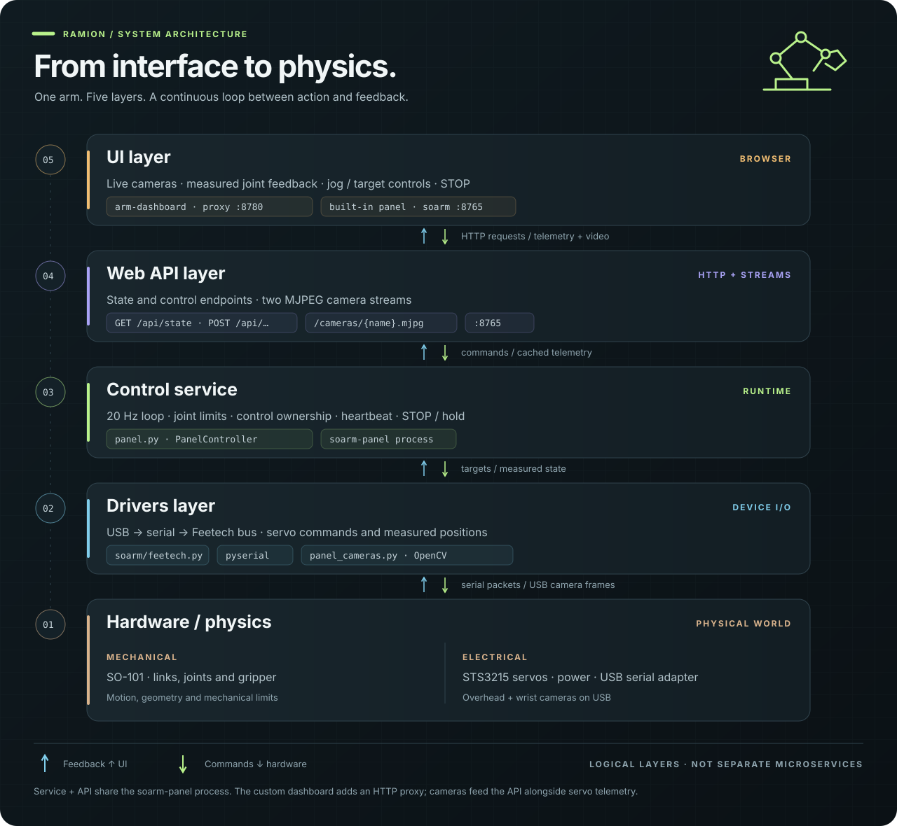

# Ramion monorepo

**Start here: [Team handoff](docs/TEAM_HANDOFF.md)** — current layout, personal setup, credentials, configuration, deployment and recovery.

[Cartesian control](docs/cartesian-control.md): eight hold-to-move controls, optional
laptop keyboard control, workspace configuration and supervised verification.

The code currently deployed on `ramion-server-01`, imported on 2026-11-03.



[Measured latency through the current VPS tunnel](docs/latency-2026-11-03.md) · raw samples and a read-only measurement script included.

[Automatic board collection](docs/automatic-collection.md): open `http://localhost:8780/map` for automatic two-camera recording and candidate mosaics, without clicking corners. [Optional metric calibration](docs/board-mapping.md) remains separate.

| Application | Purpose |
| --- | --- |
| [`apps/arm-dashboard`](apps/arm-dashboard) | The operator UI on port 8780 with the map and scan tools, plus the controller, camera and viewer proxy. |
| [`apps/arm-workbench`](apps/arm-workbench) | The controller workspace: `soarm`, its controller API on port 8765 and viewer on 8766, plus `soarm-lab` simulation/training tools. |

The source snapshots preserve the deployed files and bundled licenses. Virtual environments, caches, credentials, and the old lockfile backup are excluded. Each application's `source-snapshot.json` is a historical import record; current releases identify their commit in `.release-commit`. Importing the source does not change the running services.

## Develop

See [team setup](docs/team.md) for access and notebook conventions and
[deployment](docs/deployment.md) for packaging, switching and rolling back
reviewed releases.

Requires uv 0.13.6+ (the locks are written by it; older uv reports them out of date) and Python 3.12, which production uses for both apps (the controller workspace itself supports 3.10+). The dashboard is a FastAPI app with its own uv project and lock under `apps/arm-dashboard`.

CI (`.github/workflows/ci.yml`) runs one script per job; run the same scripts locally from the repository root before pushing:

```bash
git clone https://github.com/ramion-cloud/monorepo.git
cd monorepo
bash scripts/ci/workbench.sh   # uv sync --locked --group workbench; ruff, pyright, pytest -m 'not twin and not render'
bash scripts/ci/dashboard.sh   # uv sync --locked --extra scan; ruff, ruff format --check, pyright, pytest, legacy unittest
bash scripts/ci/node.sh        # node --test tests/*.cjs
bash scripts/ci/build.sh       # package both apps from a clean HEAD and build/verify them as deploy.sh does
```

The app scripts take stages to run only part: `bash scripts/ci/dashboard.sh lint types` (`sync`, `lint`, `types`, `test`).

The workbench tests need the `workbench` group (cameras, kinematics, viser); a plain `uv sync --locked` leaves about 25 of them failing. The dashboard collector tests and pyright need the `scan` extra.

The repository-root `tests/` hold the Node UI tests. The previous standard-library dashboard and its tests are kept in `apps/arm-dashboard/legacy/` until it is retired.

See the [controller import notes](apps/arm-workbench/IMPORT.md), [original controller documentation](apps/arm-workbench/README.md), and [dashboard run instructions](apps/arm-dashboard/README.md). The controller is kept as its own uv workspace under `apps/arm-workbench`, so its existing package paths and locked dependencies still work. Run its uv commands from that directory.

For physical operation, use the existing controller documentation and supervised start procedure. Tests use fakes or simulation; they do not establish physical movement or STOP behavior.

## Notebooks and shared stop

[Control architecture and model notebooks](docs/control-and-notebooks.md) describes the observer camera, shared stop, and server development workspace. The private monorepo is the source of truth; the older public workbench fork remains a historical snapshot.

[Host operations](docs/server-ops.md) covers SSH users, Tailscale, updates and reboot configuration.
