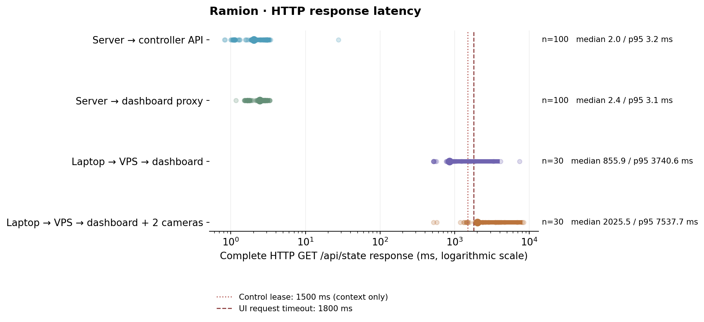

# Latency measurement · 2026-11-03

Read-only measurements of the deployed Ramion setup. No control ownership was claimed and no POSTs or physical movement commands were issued.

The main observed delay is in the remote transport path: the local API responds in about 2 ms, while the laptop path has a median of 856 ms without probe-added streams and 2026 ms with both cameras. In the two-camera sample, **18/30 responses (60%)** exceeded the dashboard's 1800 ms timeout; p95 was 7538 ms. This is consistent with the reported intermittent disconnects. It does not establish which individual TCP/SSH hop causes the stalls.

The 10-packet mean ICMP RTT was **128.3 ms laptop↔VPS** and **123.0 ms server↔VPS**, both with 0/10 packet loss. Camera delivery through the tunnel was approximately **13.0 fps overhead** and **13.6 fps wrist** during this sample. Controller feedback age on the server had a median of **25.3 ms** at the direct API, consistent with a 20 Hz cached feedback loop.

> **Follow-up:** the measurements below describe the original nested SSH web route. A direct reverse web relay and 2 fps dashboard previews were subsequently deployed; see the follow-up section at the end.



## Path and method

```text
Laptop HTTP client → localhost:8780 → SSH via VPS
  → reverse SSH tunnel → ramion-server-01 SSH
  → dashboard :8780 → controller :8765 → cached feedback
```

The current path is an SSH jump plus a reverse SSH tunnel, with several TCP/SSH connections. Server-local timings bypass the VPS. The controller and API share a process; reading state does not synchronously command or read a servo.

The Python standard-library probe uses sequential GET requests with fresh HTTP connections and a 10-second measurement timeout, recording complete JSON reception and parsing. It does not truncate observations at the UI's 1.8-second timeout. There are 100 requests per server-local endpoint, with a 50 ms pause after each response, and 30 requests per laptop phase, with a 300 ms pause after each response. The loaded phase adds two continuously consumed MJPEG streams over the same web tunnel. Existing services/users were not stopped; the baseline means no camera streams added by this probe, not a guaranteed idle network. Server-local sampling overlapped part of the laptop baseline. Percentiles use linear interpolation; these are short sequential samples, not a long-term reliability estimate.

## HTTP round-trip results

| Path | Successful n | Median ms | p95 ms | Max ms | Over UI 1800 ms |
| --- | ---: | ---: | ---: | ---: | ---: |
| Server → controller API | 100 | 2.0 | 3.2 | 27.6 | 0/100 |
| Server → dashboard proxy | 100 | 2.4 | 3.1 | 3.3 | 0/100 |
| Laptop → VPS → dashboard | 30 | 855.9 | 3740.6 | 7378.9 | 4/30 |
| Laptop → VPS → dashboard + 2 cameras | 30 | 2025.5 | 7537.7 | 8375.0 | 18/30 |

Requests counted above 1800 ms would exceed the UI's configured timeout under equivalent conditions. These GET measurements do not measure heartbeat POST acknowledgement or lease renewal; comparing round-trip time to the 1.5-second control lease is context, not a measured lease-failure rate.

## Camera transport

| Stream | First complete JPEG ms | Frames received | Received fps | Interarrival p95 ms |
| --- | ---: | ---: | ---: | ---: |
| overhead | 1771.8 | 1132 | 13.0 | 244.4 |
| wrist | 2361.8 | 1174 | 13.6 | 217.3 |

First-frame time is measured from initiating the HTTP request to receiving one complete JPEG. It includes connection setup and transfer of a cached image; **it is not sensor-to-screen latency**. Frame arrival cadence is not image freshness, and frames can arrive in bursts. Only timing/byte counts are retained, not camera images. The server currently emits no capture timestamp or frame sequence in the MJPEG parts, so true video age cannot be established here.

## What was and was not measured

- Controller state includes `age_s`, `sequence`, `loop_hz` and camera status. Raw samples retain these fields. Server-local feedback age measures the age of the controller's cached state at serialization, not physical encoder acquisition latency.
- HTTP results cover application request/response transport, not UI click handling, browser painting, actuator response or physical movement.
- The loop target is 20 Hz (50 ms). A loop period is not a measured USB round trip or movement latency.
- The UI waits 300 ms after a poll completes before starting the next one. A slow request therefore also lowers its feedback refresh rate.
- True command-to-motion latency requires a supervised physical test with command timestamps, controller receipt/USB write timestamps, encoder response and a defined displacement threshold. True glass-to-glass camera latency needs synchronized capture/display evidence. Neither is inferred from these measurements.

## Reproduce

Run from the repository root while the web tunnel is active:

```bash
python3 scripts/measure_latency.py --base http://127.0.0.1:8780 --samples 30 --with-streams --output laptop.json
```

To reproduce server-local measurements without installing or saving the probe on the server:

```bash
ssh kwiscion 'python3 - --base http://100.85.56.14:8765 --base http://100.85.56.14:8780 --samples 100 --interval 0.05' < scripts/measure_latency.py > server.json
```

Raw results and ICMP ping output are in [`measurements/`](measurements/). Ping is a separate network diagnostic, not an application latency measurement.

## Follow-up: restore localhost access

The original route later timed out even for the page itself. Capping previews alone was insufficient: the 15-request loaded retest had 4 HTTP timeouts. Its raw samples are `measurements/2026-11-03-capped-cameras.json`.

The active web route now avoids the nested SSH session:

```text
Laptop localhost:8780 → SSH to VPS → VPS loopback:18780
  → server's reverse SSH web forward → dashboard :8780 → controller :8765
```

The existing SSH shell reverse port 2223 remains separate. VPS port 18780 binds only to loopback; it is not a public web listener. The Mac LaunchAgent forwards directly to that port through the existing VPS alias. Dashboard camera transport is capped at 2 fps per stream. The hardware controller, control lease and UI safety timeouts were not changed.

A short verification sample after the change, using the same read-only probe:

| Phase | Successful n | Median ms | p95 ms | Max ms | Over UI 1800 ms |
| --- | ---: | ---: | ---: | ---: | ---: |
| No probe-added cameras | 8 | 536.3 | 626.0 | 628.7 | 0/8 |
| Both capped camera previews | 8 | 646.6 | 727.8 | 743.4 | 0/8 |

Both camera streams delivered complete JPEG frames. The controller reported connected, a healthy control loop and no faults. Raw verification samples are `measurements/2026-11-03-direct-web-relay.json`. This is a short follow-up sample, not a reliability guarantee or physical movement acceptance test.
